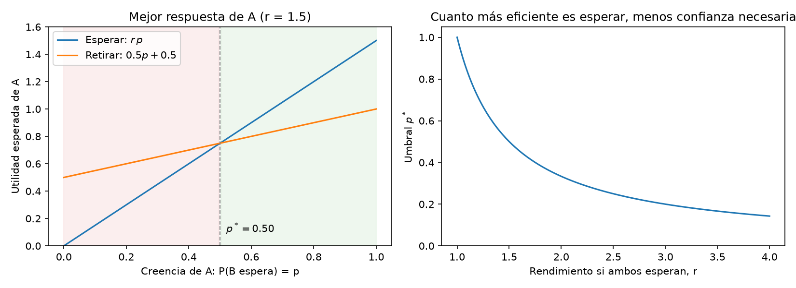
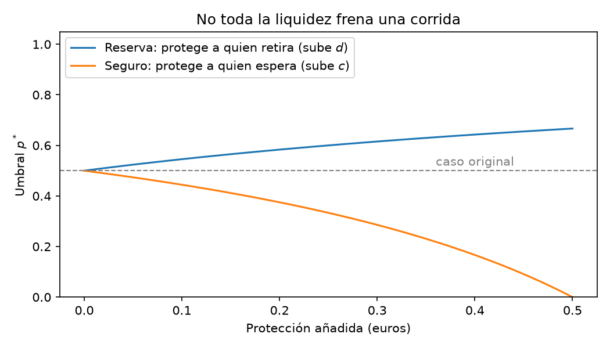
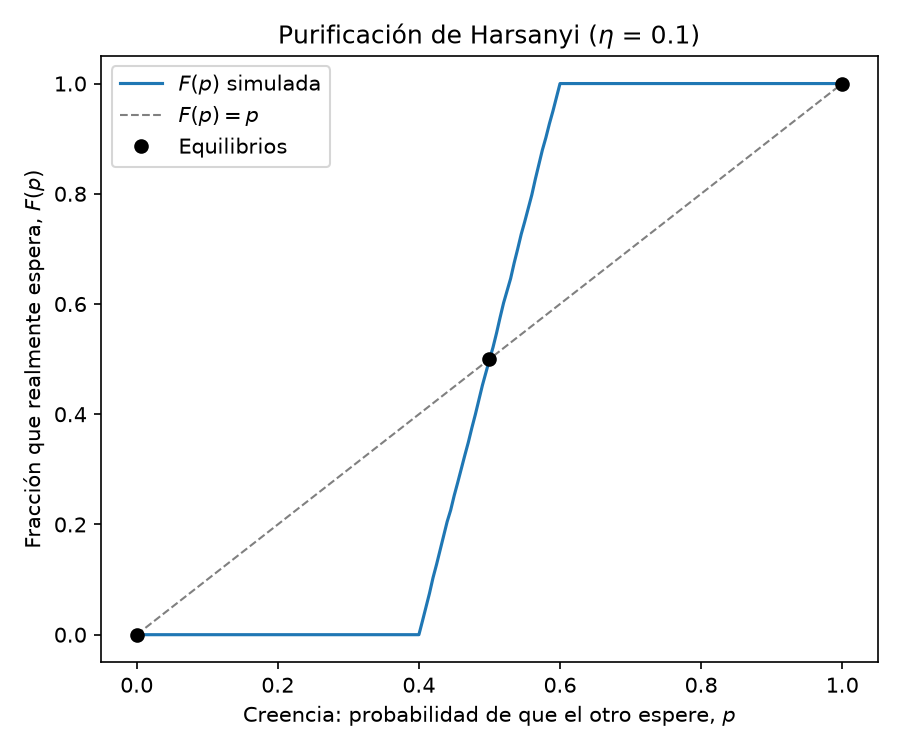

# Bank Runs as a Coordination Game

A step-by-step study of **bank runs through game theory**, starting from a minimal two-depositor model inspired by **Diamond and Dybvig (1983)** and building toward **global games** (Morris and Shin, 1998). Each notebook pairs the formal derivation with Python code that checks it numerically.

> **Status: work in progress.** Notebook 1 (static game, mixed equilibria and Harsanyi purification) is complete. Notebooks are written in Spanish.

## Motivation

Banks perform **maturity transformation**: they take deposits that can be withdrawn at any time and invest them in long-term projects. A solvent bank can therefore fail if enough depositors *believe* others will withdraw, a self-fulfilling **bank run**, as seen with Silicon Valley Bank in March 2023. This project models that coordination problem and asks which policies actually reduce fragility.

## Notebook 1: The static game (`notebooks/01_juego_estatico.ipynb`)

**Setup.** Two depositors each deposit 1 unit; the bank invests 2 units in a project that returns 3 if held to maturity and only 1 if liquidated early. Each depositor simultaneously chooses to **Wait** or **Withdraw**; early withdrawals are paid first come, first served.

**Results.**

- **Two pure-strategy Nash equilibria:** (Wait, Wait), the efficient outcome, and (Withdraw, Withdraw), the run. Verified by best-response enumeration and with `nashpy` support enumeration.
- **A mixed-strategy equilibrium at p = 0.5**, derived with the indifference principle and read as a **belief threshold**: a depositor waits only if she believes the other waits with probability above p\*.
- **Closed-form threshold:** for payoffs (r, c, d), p\* = (d − c) / ((r − 1) + (d − c)), checked against `nashpy`. With c = 0 and d = 0.5 it reduces to p\*(r) = 0.5 / (r − 0.5).
- **Policy insight:** a liquidity reserve that protects those who *withdraw* raises the threshold (0.5 → 0.615) and makes runs **easier**, whereas protection for those who *wait* (deposit insurance) lowers it toward 0 and removes the incentive to panic.
- **Harsanyi purification:** with private liquidity shocks ε ~ U[−η, η], a Monte Carlo simulation of 10,000 depositors reproduces the mixed equilibrium as the aggregate of deterministic decisions. The mixed equilibrium is **unstable** (F′(0.5) = 1/(2η) > 1): beliefs of 0.52 converge to full confidence and 0.48 to a full run.

| Belief threshold | Reserve vs. insurance | Harsanyi purification |
|---|---|---|
|  |  |  |

## Roadmap

1. ~~Static two-player game, mixed equilibria and purification~~ ✅
2. **Global games** (Morris and Shin, 1998): noisy signals about the bank's fundamentals to obtain a *unique* equilibrium and predict when a run occurs.
3. Extension to many depositors and strategic interaction in modern financial markets.

## How to run

```bash
git clone https://github.com/AsierLoz13/bank-run-game-theory.git
cd bank-run-game-theory
python -m venv .venv
# Windows: .venv\Scripts\activate    macOS/Linux: source .venv/bin/activate
pip install -r requirements.txt
jupyter lab
```

Open `notebooks/01_juego_estatico.ipynb` and run all cells; figures are saved to `figures/`.

## Repository structure

```
├── notebooks/   # Jupyter notebooks, one per stage of the project
├── figures/     # Figures generated by the notebooks
└── requirements.txt
```

## References

- Diamond, D. W. and Dybvig, P. H. (1983). Bank Runs, Deposit Insurance, and Liquidity. *Journal of Political Economy*, 91(3), 401–419.
- Harsanyi, J. C. (1973). Games with Randomly Disturbed Payoffs. *International Journal of Game Theory*, 2, 1–23.
- Morris, S. and Shin, H. S. (1998). Unique Equilibrium in a Model of Self-Fulfilling Currency Attacks. *American Economic Review*, 88(3), 587–597.

## Author

**Asier Lozano Nebreda**, Mathematical Engineering, Universidad Francisco de Vitoria. [LinkedIn](https://www.linkedin.com/in/asier-lozano-nebreda/)
